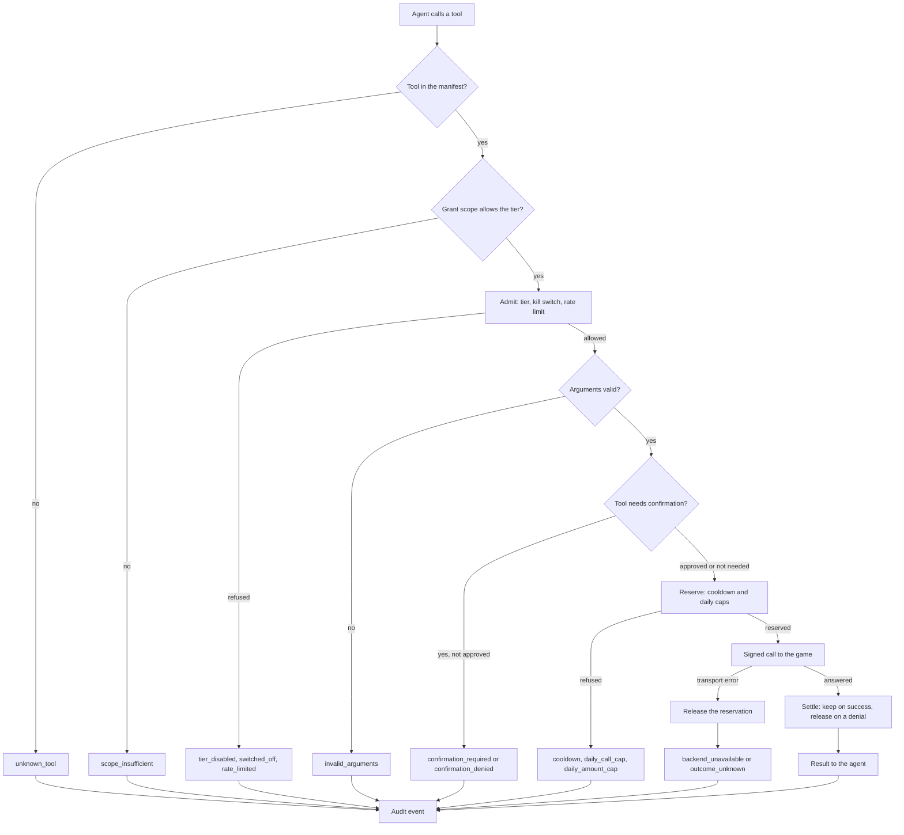

# How a call flows

Every tool call goes through the same steps, in the same order. The code is in
`internal/gateway` (`Service.call`). Expected failures are returned as results with a `code`.
Only transport problems are Go errors, so a caller fails closed.

## The steps

1. **Lookup.** The tool must exist in the active manifest. Otherwise `unknown_tool`.
2. **Scope.** A coach grant cannot call action tools, even if the agent guesses a name. This is a
   cheap, permanent answer, so it is not charged to the rate limit.
3. **Admit.** Checks the tier (sensitive tools are disabled), kill switches, and the per-minute
   rate limit. Every attempt that gets here is counted.
4. **Validate.** Types, ranges, enums, required arguments, string length, no trailing data.
5. **Confirmation gate.** Only for tools with `confirm: true`. Without the player's approval the
   call stops here.
6. **Reserve.** Claims the cooldown and the daily caps before the call.
7. **Signed call.** The connector sends a signed request to your backend (or down the relay socket).
8. **Settle.** A successful call keeps the claim. A failure releases it.
9. **Audit.** One event per attempt, whatever the outcome, with a hash of the arguments.

## Why this order

- **Rate limit before validation.** If invalid calls were free, an agent could hammer the gateway
  with garbage at no cost. Counting every attempt keeps the limit honest. This is a rule in
  `AGENTS.md`: never move it after validation.
- **Validate before Reserve.** A call with bad arguments must not use up a cap or start a cooldown.
- **Reserve before the call.** Two calls at the same moment cannot both pass a cap, because the
  claim is made first. This is why concurrent calls cannot exceed a daily amount.
- **Release on failure.** If the game could not be reached, or said no, the player gets the cap and
  the approval back and no cooldown starts. Only a call that worked costs anything.
- **The approval is one use.** It is bound to the exact tool and arguments, and it is returned if
  the call fails.
- **Audit always.** Bookkeeping (release, settle, audit) runs even if the agent disconnects, with
  its own 5 second limit, so a cancelled request still leaves a record and gives its claim back.

## Two answers worth knowing

- **`backend_unavailable`**: the gateway could not reach the game. Nothing was changed.
- **`outcome_unknown`**: the call was cut off (cancelled or timed out) after it may have reached the
  game. The game may or may not have applied it. The agent should check state before trying again.

## Policy outages fail closed

If the policy store (Redis) cannot be reached, Admit and Reserve return `policy_unavailable` and
the call is refused, reads included. The same goes for the confirmation store
(`confirmation_unavailable`). See [tiers and policy](tiers-and-policy.md).

## More

[Architecture](../ARCHITECTURE.md), [security model](../SECURITY-MODEL.md), and the
[signed request protocol](../PROTOCOL.md).
