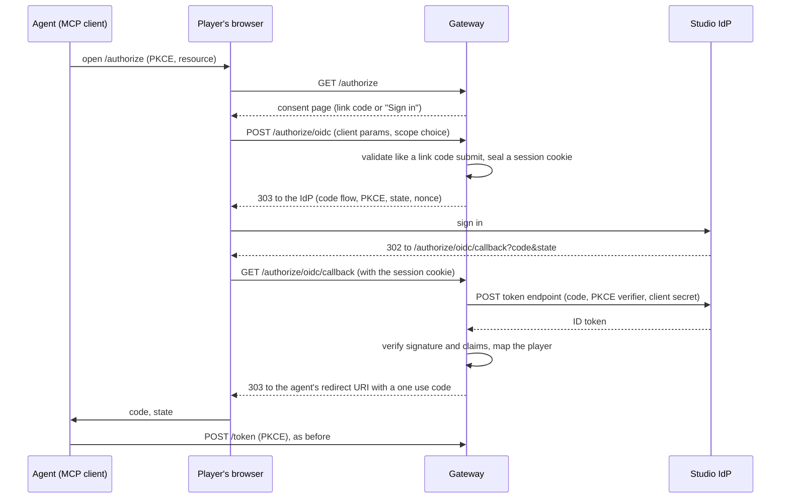

# Design: OIDC sign-in at the consent page

Status: **built** (M3). Option (i), the `go-oidc` verifier, was chosen; see "Decision". Run it with
the [runbook section](../RUNBOOK.md#sign-in-with-your-identity-provider-oidc).

## What it is for

Today a player proves who they are at the consent page with a **link code**. The studio's
backend, which already has the player logged in, mints a single-use ticket through the signed
`POST /v1/studio/link-tickets` call and shows the code to the player (see
[players, grants and confirmations](../concepts/players-grants-confirmations.md)).

That works well when the studio has a web backend with a logged-in session. It works badly when:

- the studio has no website, only a game client, and cannot show a code at the right moment;
- the studio already runs single sign-on (an OIDC identity provider, "IdP") and wants players to
  use it, with no copy and paste.

OIDC at consent adds a second way in. The consent page gets a button, **Sign in with your game
account**. The player signs in at the studio's IdP, the IdP tells the gateway who they are, and
the gateway records the grant for that player. The link code stays. A studio can offer one or both.

If your backend can already mint link tickets, you do not need this.

## The flow

Two PKCE legs are involved and they are independent: the agent's (agent to gateway, unchanged)
and the gateway's own (gateway to IdP, new).

## What the gateway trusts, and when

| Input | Trusted? | Why |
|---|---|---|
| The consent form fields | No | Validated exactly like a link code submit: client, redirect URI, PKCE, resource, scope, the coach cap, the rate limit |
| The session cookie | Yes, after decryption | AES-256-GCM sealed with a server secret. It holds the validated request, `state`, `nonce` and the gateway's PKCE verifier |
| `state` in the callback | Only if it equals the cookie's | Binds the callback to the browser that started it |
| The ID token | Only after the Verifier and `CheckClaims` | See below |
| `iss` in the callback | Checked when present | RFC 9207 mix-up defense |

The sealed cookie replaces server-side state. Nothing is stored for a sign-in that is never
finished, there is no table to prune, and any replica can finish a sign-in another one started,
as long as they share the session secret.

## ID token validation

Done in two layers, so a mistake in one does not open the door:

1. **The `Verifier`** (the interface this package is built around) authenticates the token: the
   signature against the IdP's keys (JWKS), with an algorithm allow-list (RS256 and ES256, never
   `none` and never a symmetric algorithm), key selection by `kid`, and JWKS caching with refresh
   when an unknown `kid` appears (key rotation). It also checks issuer, audience, `exp` and nonce.
2. **`CheckClaims`** (always run, standard library only) checks again:
   - `iss` equals the configured issuer exactly (no trailing slash tolerance);
   - the audience contains the client id, and with several audiences `azp` is present and equal
     to the client id (OIDC Core 3.1.3.7); an `azp` that names someone else is refused;
   - `nonce` equals the one this sign-in sent, compared in constant time, and is never empty;
   - `exp` has not passed, with 1 minute of clock skew; `nbf` has arrived; `iat` is not in the
     future and the token is no older than 10 minutes (so an old token cannot be replayed into a
     new sign-in).

The ID token is discarded after verification. Only the player claim is used. No access token or
refresh token from the IdP is stored, and the gateway asks the IdP for `openid` only unless
`--oidc-scopes` adds more.

## Mapping an IdP identity to a player id

The grant is stored for a **player id**, and that id is what the studio's backend sees in the
signed `X-AG-Player` header on every call. So the claim must be the studio's own player id.

- `--oidc-player-claim` names the claim. Default `sub`. A studio whose `sub` is not its player id
  asks its IdP to emit a custom claim (for example `player_id`) and names it here.
- The value must be a string or an integral number, 1 to 128 printable ASCII characters with no
  spaces. Anything else (missing, empty, fractional, an array, control characters, non-ASCII) is
  refused, not repaired. This is the same rule as every other player id the gateway signs.
- **It must be stable for ever.** An email address, a display name or a username changes, and a
  changed value is a different player: the old player's grants stay behind and the new player
  starts with none. Never map on those.

Edge cases:

| Case | What happens |
|---|---|
| Two IdP accounts for one player | The IdP must emit the same claim for both. The gateway does not merge players |
| The IdP reassigns a `sub` to someone else | They would inherit the old grants. Use a claim the studio controls |
| The player signs in with a different account than the one logged into the game | The grant goes to the claim's player. The studio's own UI shows the grant under that player |
| Same player, link code on one device, OIDC on another | One grant per (player, client, resource), as today: the second consent updates its scope |
| A banned player | The studio revokes with `DELETE /v1/studio/grants`. Revoking at the IdP does not revoke grants (below) |

## Failure behavior: fail closed

Every failure ends without a grant. What the agent and the player see:

| Failure | Result |
|---|---|
| IdP unreachable when the consent page is drawn | The button is not shown. The link code still works |
| IdP unreachable when the player clicks | 503 page: use a link code or try later |
| The player refuses at the IdP | The agent's redirect URI gets `error=access_denied` |
| Token endpoint fails or answers without an `id_token` | `error=temporarily_unavailable` |
| Bad signature, wrong issuer, audience, nonce, expired token, missing player claim | `error=access_denied`, `sign-in failed`. The reason is for logs only and is never sent to the agent or shown to the player |
| No session cookie, tampered, expired, wrong `state`, replayed | An error page. **Nothing is redirected**, because nothing about who asked can be trusted |
| A flow that reports success with no player | Treated as a failure |

## CSRF, state, nonce, open redirects

- **Login CSRF.** The cookie is HttpOnly, `SameSite=Lax` (Strict would drop it on the IdP's
  redirect, which is a top level navigation), `Secure` and named `__Secure-agw_oidc` when the
  gateway is https, and sent only to the callback path. The callback requires the cookie and a
  matching `state`. An attacker cannot hand a victim a callback that finishes the attacker's
  own sign-in.
- **Replay.** A sign-in is single use: the cookie is cleared on the first callback, and the
  `state` is remembered for the session's lifetime so a replayed callback is refused before it
  reaches the token endpoint. The memory is per process and bounded (full means refuse, not
  grow); the IdP's one-time authorization code is the backstop across replicas.
- **Nonce.** 128 random bits per sign-in, sent to the IdP, compared with the token's. It ties
  the token to this sign-in.
- **PKCE** on the gateway-to-IdP leg: S256, a 256 bit verifier kept only in the sealed cookie.
- **Open redirect.** The gateway never redirects to a URL from the callback request. The IdP
  redirect URI is fixed configuration. The only redirect back to the agent is to a redirect URI
  registered by that client, and the stored request is validated **again** at the callback, so
  a session that outlived a client's registration redirects nowhere.
- **Form posts and CSP.** Browsers apply `form-action` to the redirect that answers a form post,
  so the consent page adds the IdP's origin to it, only when OIDC is on and the IdP answers.
- **No redirects followed** when the gateway calls the IdP, and discovery and token URLs must be
  https (plain http only for a loopback IdP, with an explicit opt-in, for tests and demos).
  A discovery document that names a different issuer is refused.

## Logout and revocation

The gateway keeps no IdP session and does not log the player out of the IdP. Signing out of the
IdP, or disabling the account there, does **not** revoke grants that already exist: a grant is
the player's consent for an agent, and it lives until the player or the studio revokes it
(`GET` and `DELETE /v1/studio/grants`, or the game's own screen). A studio that wants account
disabling to cut agents off calls the revoke endpoint from its account-disable path. OIDC
back-channel logout is a possible later addition and is not part of this design.

## Configuration

These flags are **not wired yet** (they need the verifier below; see "What is built"). Planned:

| Flag or variable | Meaning |
|---|---|
| `--oidc-issuer` | The IdP's issuer URL. Setting it turns the feature on |
| `--oidc-client-id` | The client id registered at the IdP |
| `AGENTGW_OIDC_CLIENT_SECRET` | The client secret. Environment only, never a flag. Empty means a public client (PKCE only) |
| `AGENTGW_OIDC_SESSION_SECRET` | At least 32 random bytes sealing the session cookie. Share it across replicas |
| `--oidc-player-claim` | The claim holding the player id. Default `sub` |
| `--oidc-scopes` | Extra scopes besides `openid` |

Register `<public-url>/authorize/oidc/callback` at the IdP as the redirect URI.

## Implementation options

The signature check is the part where homegrown code goes wrong: algorithm confusion, trusting the token's own `kid` or `jwk`, tiny keys, bad curve points,
a JWKS cache that can be poisoned or never refreshes. Three ways to get it:

| | (i) `go-oidc` verifier | (ii) In-house verifier | (iii) Reverse proxy |
|---|---|---|---|
| What | `github.com/coreos/go-oidc/v3` for discovery, JWKS and signature checks, used through a ~40 line adapter | About 300 to 400 lines of standard library: JWT parsing, RS256 and ES256, JWKS fetch, cache and rotation | Put an OIDC-aware proxy (oauth2-proxy, Envoy and similar) in front of a studio login page that mints a link ticket |
| New dependencies | `go-oidc/v3` (Apache-2.0) and `github.com/go-jose/go-jose/v4` (Apache-2.0). It also links `golang.org/x/oauth2` (BSD-3-Clause), which is already an indirect dependency. The exact transitive set must be confirmed with `go get` and `go mod why` at adoption | None | None in the gateway |
| Who reviews the crypto | A widely used library, including in Kubernetes' OIDC authenticator | Only this project | The proxy's maintainers |
| Cost of being wrong | Low: upstream fixes arrive with a version bump | High: a verification bug is an authentication bypass | Low, but the gateway then sees only a ticket, not an IdP |
| Fits the "few dependencies" rule | Adds two, with a reason | Yes | Yes |
| Gives the player a sign-in button on the consent page | Yes | Yes | No, the flow lives in the studio's page |

### Decision

**Option (i), chosen.** Verifying a signature against rotating keys is exactly where a project should rely
on a reviewed library, and the two dependencies are permissively licensed. Everything else (flow,
state, nonce, PKCE, claim checks, player mapping, cookie, handlers) is already ours and tested, so
the library is confined to one small adapter:

The adapter is `internal/auth/oidc/verifier_goidc.go` (`NewGoOIDCVerifier`). It is a little larger
than the first sketch because it also pins the algorithm list, refuses redirects and plain http
issuers, and maps every library error to the flow's own error values.

`go-oidc` does not check the nonce itself; `CheckClaims` does. Option (iii) remains the right
answer for a studio that wants no IdP integration in the gateway at all.

## What is built

In `internal/auth/oidc`:

- `GoOIDCVerifier`, the go-oidc adapter: discovery, JWKS fetch and rotation, and the signature
  check against an allow-list of asymmetric algorithms. This is the only code that imports go-oidc.
- `Verifier` and `Config`; `CheckClaims`; `PlayerID`.
- `Flow` with `Begin` and `Complete`: discovery (cached, issuer checked), PKCE, `state` and
  `nonce`, the AES-GCM session cookie, the code exchange (client secret as Basic auth, no
  redirects followed), the replay cache.
- Tests for state mismatch, nonce mismatch, expired and too old tokens, wrong audience, wrong
  `azp`, wrong issuer, missing or bad player claim, a tampered, expired or foreign cookie, a
  replayed callback, token endpoint failures and redirects, and bad configuration.

In `internal/auth`:

- `ServerConfig.OIDC` (nil by default, so nothing changes), the `OIDCLogin` interface, the consent
  page button and form-action origin, `POST /authorize/oidc` and `GET /authorize/oidc/callback`.
- Tests with a fake flow for the consent page, open redirect, CSRF, replay, denial, scope under
  the coach cap, the rate limit, and an end to end sign-in that yields a grant and tokens.

In `cmd/gateway`:

- `buildOIDC` turns the `--oidc-*` flags and the two secrets into a `Flow` and checks everything
  at start (secrets present, algorithm list safe, provider reachable, issuer matches its own
  document). `RedirectURL` is the public URL plus `auth.OIDCCallbackPath`. The flow is passed as
  `auth.ServerConfig.OIDC`; with no `--oidc-issuer` it stays nil and the two routes answer 404.
- Tests: the start checks, and an end to end sign-in through `buildOIDC` against a fake provider
  with real RSA keys that checks the client secret and PKCE verifier at its token endpoint. It also
  covers a token signed by an unpublished key and a callback without the starting browser's cookie.

In the Helm chart: the `oidc` values, with both secrets read from `existingSecret`.

## What is not built

- A tutorial.
- A test against a real provider (for example a Dex container). The fake provider proves the
  protocol and the checks; it cannot prove a given vendor's quirks, such as which claim carries a
  stable player id or how it rotates keys.
